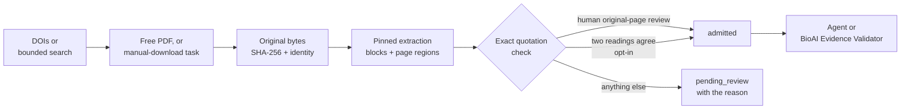

<p align="center">
  
</p>

<h1 align="center">EvidPort</h1>

<p align="center">
  <b>Traceable evidence for AI agents.</b><br>
  Every quotation an agent uses is tied to the original PDF, the exact page region and a recorded check.<br>
  If that chain is missing, the quotation is not admitted.
</p>

<p align="center">
  <a href="https://github.com/NingyuSUN/evidport/actions/workflows/ci.yml"></a>
  <a href="pyproject.toml"></a>
  <a href="LICENSE"></a>
  <a href="docs/MCP_USAGE.md"></a>
  
</p>

<p align="center">
  <a href="#quickstart">Quickstart</a> ·
  <a href="#how-it-works">How it works</a> ·
  <a href="#use-it-from-an-ai-client">MCP</a> ·
  <a href="#fewer-quotations-for-a-person-to-check">Machine verification</a> ·
  <a href="#documentation">Docs</a> ·
  <a href="#limits">Limits</a>
</p>

---

## Why

An AI agent that cites a paper can be wrong in three ways that look identical in its answer:

| What goes wrong | Example | What EvidPort does |
|---|---|---|
| The quotation is not in the paper | A fluent sentence the model composed | Matches the complete quotation against the pinned extraction; no match, no admission |
| It is in a different paper or file | A supplement, a preprint, a mislabelled PDF | Hashes the original bytes and checks the publication identity before any text is used |
| The extracted text is not what the page prints | `500 µl` stored as `500 ml`, `10⁻⁸` stored as `10-8` | Requires a check against the original page: by a person, or by an independent second reading |

Missing full text stays visible as a DOI download task. Bibliographic metadata never becomes a
quotation.

## Features

- **Acquisition with a paper trail.** DOIs or a bounded literature search become free-PDF candidates
  or a manual-download list. Every file is kept as original bytes with its SHA-256 and identity checks.
- **Pinned versions.** Each extraction is a version. A citation such as
  `evidence:CONVERSION_ID#BLOCK_ID` names one version and one block; newer versions never inherit
  older approvals. Main articles and supplements have separate identities.
- **Page locations.** Blocks carry their page and region, and a review packet puts the extracted
  text next to the rendered page.
- **A real admission gate.** A quotation is admitted only after a recorded human original-page
  review or, if you turn it on, when two independent readings of the page agree.
- **Three ways in.** Python API, the `evidence-db` CLI, and an optional local MCP server for AI
  clients. All three share the same checks.
- **Local and offline by default.** No model API and no GPU. Network acquisition is an explicit switch.

## How it works



## Quickstart

Python 3.11+. Work in a local directory outside cloud-sync folders.

```sh
git clone https://github.com/NingyuSUN/evidport.git
cd evidport
python -m pip install -e '.[pdf]'
```

Edit [examples/project.json](examples/project.json) to list your papers, then fetch and extract:

```sh
evidence-db project --config examples/project.json sync --fetch
evidence-db project --config examples/project.json status
```

Each run writes a receipt and a pending list (CSV, TSV and JSON) of papers that could not be
fetched. Save those PDFs in the configured inbox under the suggested filename and run `sync`
again without `--fetch`. Unknown files stay untouched.

Find a passage and check a quotation against it:

```sh
evidence-db --db data/evidence search 'sample size'
evidence-db --db data/evidence show  --citation 'evidence:CONVERSION_ID#BLOCK_ID'
evidence-db --db data/evidence check --citation 'evidence:CONVERSION_ID#BLOCK_ID' --quote 'Exact quotation'
evidence-db --db data/evidence show  --citation 'evidence:CONVERSION_ID#BLOCK_ID' --sentences
evidence-db --db data/evidence check --citation 'evidence:CONVERSION_ID#BLOCK_ID' --sentences 2-3
```

The last two take the quotation from the stored text by sentence position, so nothing typed can
differ from the source. A typed quotation that is not found comes back with the stored text it
corresponds to, if there is exactly one such place.

`check` answers with the decision and how it was reached (shortened here):

```json
{"admitted": true, "reason": "independent_reading_agreement", "admission_route": "independent_reading",
 "machine_verification": {"status": "agrees", "blocking": [], "engine": "tesseract"},
 "review_id": null, "scientifically_verified": false}
```

`evidence-db ... packet` builds the material for a human review; `check --inspect` tests text
presence only and never admits evidence. See [Project workflow](docs/PROJECT_WORKFLOW.md).

## Use it from an AI client

The optional MCP server exposes the same workflow to Claude, Codex or any MCP client as a local
stdio subprocess.

```sh
python -m pip install -e '.[mcp,pdf]'
evidport-mcp --project-config examples/project.json
```

```json
{
  "mcpServers": {
    "evidport": {
      "type": "stdio",
      "command": "python",
      "args": ["-m", "evidence_database.mcp_server", "--project-config", "examples/project.json"],
      "env": {"PYTHONIOENCODING": "utf-8", "PYTHONUTF8": "1"}
    }
  }
}
```

| Area | Tools |
|---|---|
| Catalogue and DOI tasks | `evidport_papers_status`, `evidport_papers_pending` |
| Acquisition and extraction | `evidport_papers_discover`, `evidport_papers_acquire`, `evidport_papers_import`, `evidport_papers_convert` |
| Evidence | `evidport_evidence_search`, `evidport_evidence_get`, `evidport_evidence_check_quote`, `evidport_evidence_versions` |
| Review material and jobs | `evidport_evidence_prepare_review`, `evidport_job_status`, `evidport_job_cancel` |

Thirteen tools in all, plus four resource templates for blocks, continuation chunks, original
page images and review packets. The server is offline unless started with `--allow-network`, and
it has no human-approval tool: an agent cannot approve its own evidence. Follow
[MCP usage](docs/MCP_USAGE.md) for configuration and [agent reading rules](docs/AGENT_USAGE.md)
for how an agent should use what it retrieves.

## Fewer quotations for a person to check

A person reviewing a quotation checks one thing: that the extracted characters are the printed
ones. Most of that can be done by machine. With an OCR command configured, EvidPort reads every
paragraph a second time from the rendered page and admits a quotation when both readings agree
and the quoted characters touch no known text-layer defect, superscript or symbol-font letter.
Everything else stays with a person, with the reason stated.

```json
"verification": {"admission": "independent_reading", "ocr_command": ["tesseract"]}
```

Measured on 12 papers, 4,553 sentences of eight or more words:

| Sentences | Admitted without a person |
|---|---|
| All | **72.2%** |
| Without digits | 87.9% |
| With digits | 58.0% |

Agreement is not proof, so it was tested: all 3,144 sentences admitted under the first rules were
read a third time with an unrelated OCR engine, and 198 differing places were compared with the
rendered page. The text layer was right in 197. The one error, a Greek α extracted as `a` from a
publisher symbol font, led to the symbol-font rule, which also holds back cases such as µ
extracted as `m`.

This is off by default, never writes a review record and is always reported as
`independent_reading`, not as human review. The page comparison was made by an AI assistant, and
12 papers is a small sample. Details and limits: [machine verification](docs/MACHINE_VERIFICATION.md).

## With BioAI Evidence Validator

[BioAI Evidence Validator](https://github.com/NingyuSUN/bioai-evidence-validator) decides whether
an AI-produced record may be used. EvidPort supplies the evidence side: the validator binds the
PDF hash, publication identifier, exact citation and quotation, and opens the store read-only.

```sh
bioevidence validate record.json --profile literature-claim --evidence-library data/evidence
bioevidence validate record.json --profile literature-claim --evidence-library data/evidence --accept-independent-reading
```

The first command accepts only a recorded human review. The second also accepts machine-verified
quotations, recomputed by the validator itself. Through the validator's MCP consumer, citations
are retrieved from the server and checked again against the local library; protocol failures and
disagreements are rejected rather than trusted. See
[MCP usage](docs/MCP_USAGE.md#validate-a-proposed-record).

## Documentation

| Guide | Covers |
|---|---|
| [Project workflow](docs/PROJECT_WORKFLOW.md) | Project configuration, manual intake, resuming a sync |
| [MCP usage](docs/MCP_USAGE.md) | Client configuration, tools, the download-to-validator flow |
| [Agent reading rules](docs/AGENT_USAGE.md) | How an agent should cite, and what it must not claim |
| [Machine verification](docs/MACHINE_VERIFICATION.md) | The second reading, blocking reasons, measured accuracy |
| [Project index](PROJECT_INDEX.md) | Current status, validation records and history |

For compatibility the distribution is named `local-evidence-database`, the Python module
`evidence_database` and the CLI `evidence-db`.

## Development

```sh
python -m pip install -e '.[pdf,mcp,dev]'
python -m pytest
python -m ruff check src tests
evidence-db --db data/evidence audit
```

Tests cover synthetic identity mistakes, corrupted artifacts, stale versions, review and
revocation, workflow resumption and machine verification. Private papers, databases and model
weights are not part of the repository. The
[MCP acceptance summary](evaluation/mcp-local-20261111.json) records a separate real-paper
check on nine papers, three of them repeated through manual intake.

## Limits

- **Admission is about transcription, not truth.** An admitted quotation is in the pinned original
  and was checked against its page. Whether it supports a claim is a separate question.
- **No coverage guarantee.** The store holds the papers you declare; an empty search does not show
  that no relevant paper exists.
- **Machine verification can share an error.** Two readings can be wrong the same way in a class
  not yet seen. Scanned pages without a text layer are not machine-verified.
- **Local, single-user.** Reviewer identity is self-declared. Hashes do not protect against an
  administrator rewriting the whole store. Read-only access supports SQLite DELETE mode; WAL mode
  is refused to avoid sidecar-file writes.
- **Engineering validation only.** The measurements here test retrieval and quotation checks. They
  are not a scientific accuracy benchmark or a measured reduction in hallucinations.

## License and citation

Code: [Apache-2.0](LICENSE). Dependencies, models and papers retain their own licenses.
To cite EvidPort, use [CITATION.cff](CITATION.cff) (GitHub's "Cite this repository" button).
